

  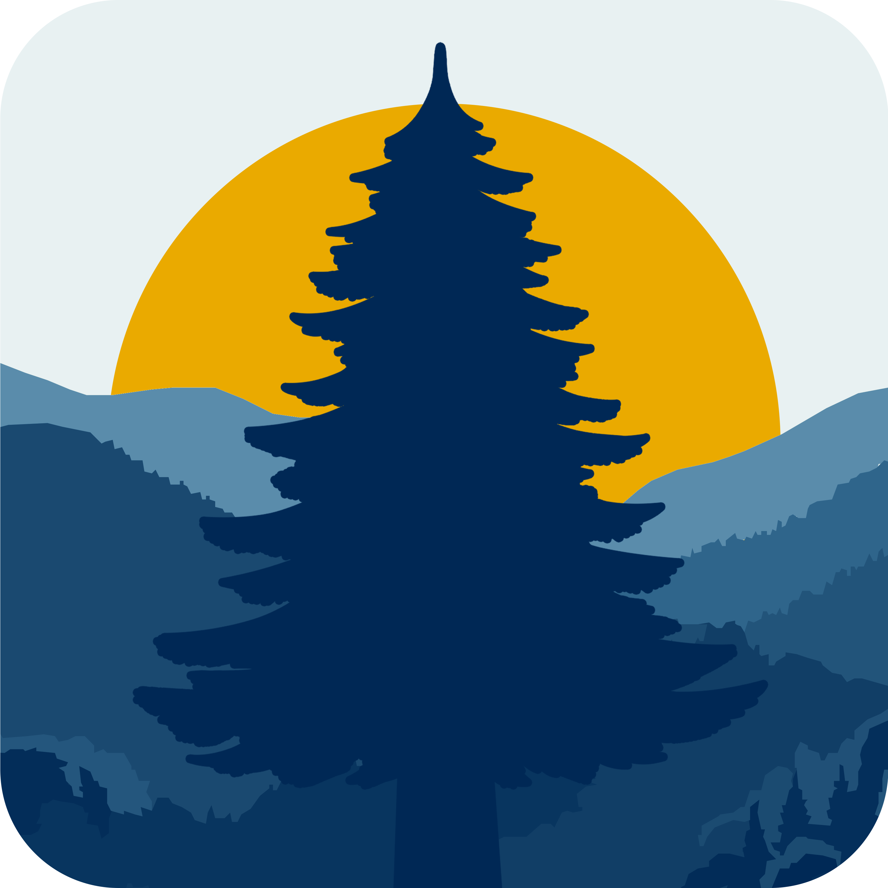

<h1 align="center">Tamarack</h1>

<b>Your movies, TV shows and Live TV, on Windows, Android and Roku.</b>

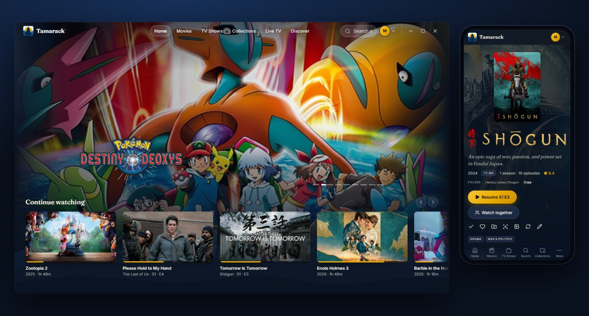

Tamarack is the movies-and-TV app for **[Seneca](https://github.com/GetHorizontal63/seneca)**, a media server you run at home. Enter your server's address, sign in, and your library is there: posters, seasons and episodes, *Continue watching*, and Live TV channels with a programme guide. What you've watched and where you stopped are kept on the server, so you can carry on in a browser, on your phone or on the TV.

  <a href="https://github.com/GetHorizontal63/tamarack/releases/latest/download/Tamarack-Setup.exe"><b>⬇ Windows</b></a> ·
  <a href="https://github.com/GetHorizontal63/tamarack/releases/latest/download/Tamarack.apk"><b>⬇ Android</b></a> ·
  <a href="https://github.com/GetHorizontal63/tamarack/releases/latest/download/Tamarack-Roku.zip"><b>⬇ Roku</b></a> ·
  <a href="https://github.com/GetHorizontal63/tamarack/releases">All releases</a> ·
  <a href="https://github.com/GetHorizontal63/seneca">Seneca (the server)</a>

| | |
|---|---|
| Latest version | see **[Releases](https://github.com/GetHorizontal63/tamarack/releases/latest)**; the links above always get the newest |
| Needs | a Seneca server on your network, and Windows 10 or 11 (64-bit), Android 7.0 or newer, or a Roku in developer mode |
| Music | left out on Windows and Android: that's **[Holler](https://github.com/GetHorizontal63/holler)**. In a browser and on Roku, Tamarack has both. |

---

## Contents

| | |
|---|---|
| [Install](#install) | Windows, Android and Roku, then connecting |
| [The screen at a glance](#screen) | What everything does, with pictures |
| [On your phone](#phone) | The same, sized for a phone |
| [On Roku](#roku-use) | The remote's buttons |
| [Updating](#updating) | It updates itself |
| [Something wrong?](#something-wrong) | Fixes, step by step |
| [For server managers](#for-server-managers) · [For developers](#for-developers) | |

---

## Install

You need a Seneca server on your network and its address, which looks like **`http://192.168.1.50:8430`**. If you run the server yourself, see [Seneca's quick start](https://github.com/GetHorizontal63/seneca#quick-start); otherwise ask whoever does.

> [!TIP]
> Nothing to install to try it: open that address in any web browser. That's Tamarack too.

| Windows | Android |
|---|---|
| 1. Download **[Tamarack-Setup.exe](https://github.com/GetHorizontal63/tamarack/releases/latest/download/Tamarack-Setup.exe)** and run it. 2. If Windows says the publisher is unknown (the app isn't signed with a paid certificate), press **More info → Run anyway**. 3. Tamarack installs and opens; it's in the Start menu from then on.  To remove it: **Settings → Apps → Installed apps → Tamarack → Uninstall**. | 1. On your phone, open **[Tamarack.apk](https://github.com/GetHorizontal63/tamarack/releases/latest/download/Tamarack.apk)**. 2. Open the downloaded file. Android asks to **allow installing unknown apps** for your browser: allow it, go back, press **Install**. 3. If Play Protect doesn't recognise the developer, press **More details → Install anyway**. |

### Roku

Tamarack for Roku is a *developer channel*: you install it yourself, once, in about five minutes.

1. **Turn on developer mode.** With the remote, on the Home screen, press **Home ×3, Up ×2, Right, Left, Right, Left, Right**. Agree to the licence, **choose a password and write it down** (updates need it), and let the Roku restart. The screen shows its address, such as `http://192.168.1.60`.
2. **Download [Tamarack-Roku.zip](https://github.com/GetHorizontal63/tamarack/releases/latest/download/Tamarack-Roku.zip)** on a computer on the same network. Don't unzip it.
3. **Install it:** open the Roku's address in a browser, sign in as **`rokudev`** with your password, press **Upload**, choose the zip, then **Install**.
4. Tamarack opens on the TV and stays on the Roku's Home screen. (A Roku holds one developer channel; a newer zip replaces it.)

### Connect and sign in

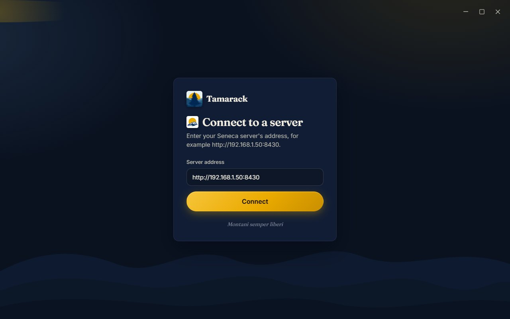

1. Type the server's address. On Windows and Android, in full: **`http://192.168.1.50:8430`**. On a Roku, `192.168.1.50` is enough.
2. Press **Connect**, then sign in with your Seneca username and password.

To use another server later: **Settings → Server → Change server**.

---

## The screen at a glance

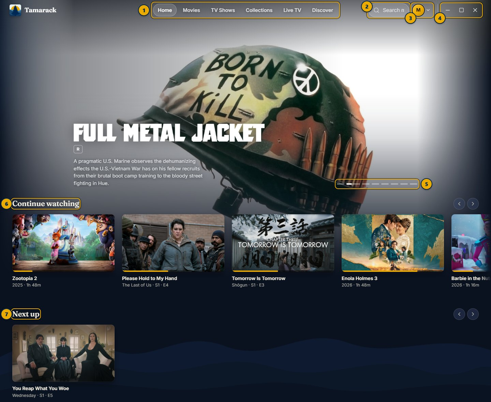

| # | What it is | What it does |
|:-:|---|---|
| 1 | **Sections** | Home, Movies, TV Shows, Collections, Live TV and Discover. |
| 2 | **Search** | Films, shows, episodes and people, as you type. |
| 3 | **Your menu** | Your picture: Settings, Administration (administrators) and Sign out. |
| 4 | **Window buttons** | Minimise, maximise and close. The app has no title bar: drag the header to move the window. Press **Alt** for the menu. |
| 5 | **Featured** | What you were watching, or the newest arrivals. Click the title for its page; the bars switch between them. |
| 6 | **Continue watching** | Everything you've started, with how far you got. |
| 7 | **Next up** | The next episode of each show you're watching. |

### A show's page

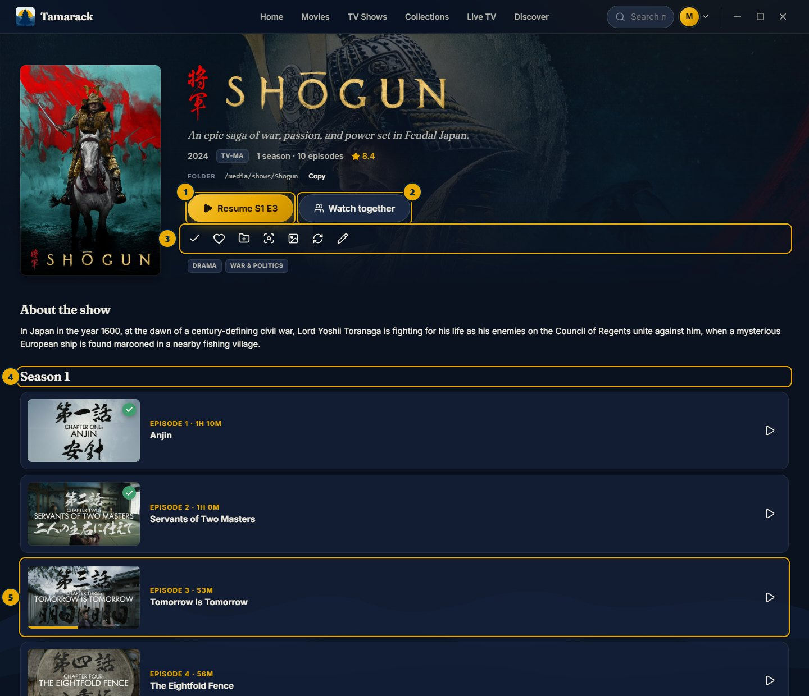

| # | | |
|:-:|---|---|
| 1 | **Resume** | Carries on with the episode you're on (here, season 1, episode 3). |
| 2 | **Watch together** | A room where everyone sees the same moment; play, pause and jumps are shared. |
| 3 | **Actions** | Mark watched · Favorite · Add to a collection · and for administrators Identify, Pictures, Refresh and Edit details. |
| 4 | **Seasons** | Each season's episodes. |
| 5 | **An episode** | A tick when watched, a bar when part-way through. Click to play. |

A film's page is the same, with its quality (4K, HDR…), sound and subtitles, and a choice of picture quality for this device. Stay on a page and it starts by itself after 15 seconds (**Settings → Playback** turns that off).

### Playing

Subtitles, sound, quality and full screen are bottom right. **Space** play/pause · **←** back 10 s · **→** forward 30 s · **F** full screen · **M** mute · **Esc** leave. If a film stutters, choose a lower quality: the server is converting it and can't keep up.

### Live TV

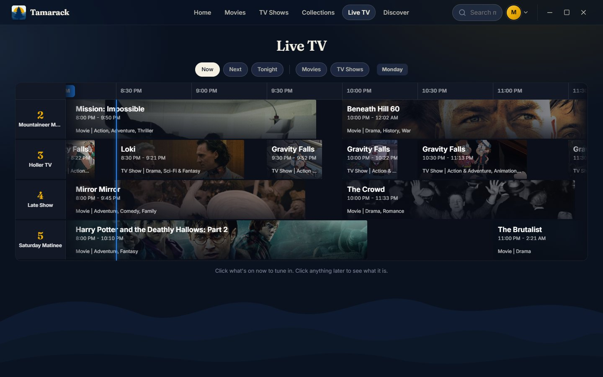

Channels of your own films and shows, round the clock. Time runs across, channels down; the line marks now. **Click what's on** to tune in where it's got to; click anything later to see what it is. **Now**, **Next** and **Tonight** jump through the day; **Movies** and **TV Shows** filter it.

### Collections and Discover

**Collections** are your own lists of films and shows, in your order: press the **folder +** on a page, or right-click a poster to start selecting. **Discover** shows what's coming out and what's popular; the **+** on a poster asks your administrator for it.

---

## On your phone

| Home | A show | Live TV |
|---|---|---|
| 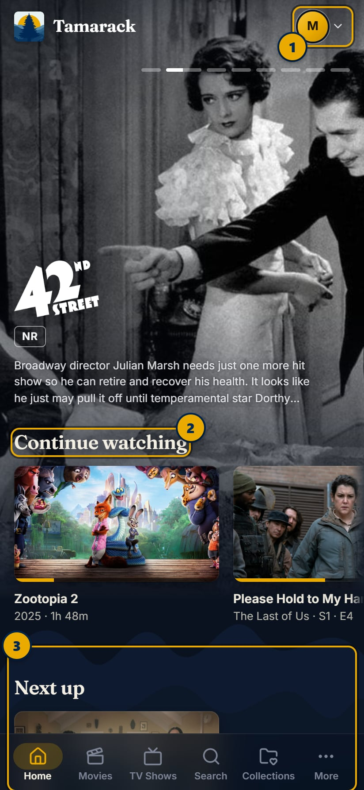 | 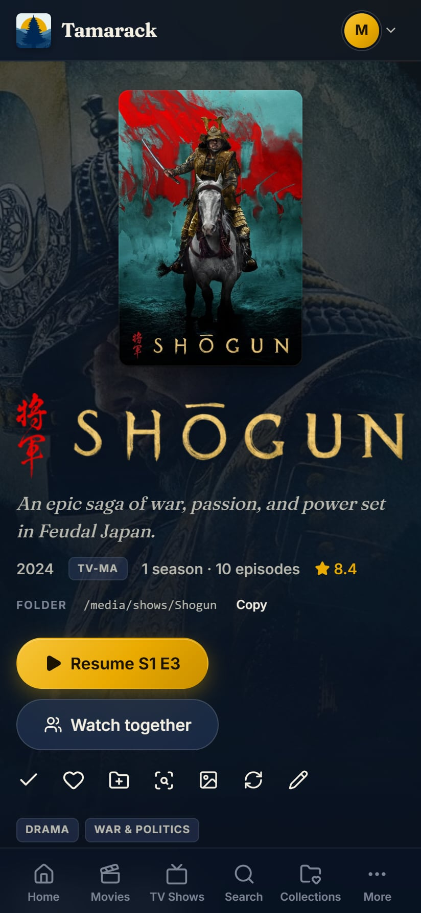 | 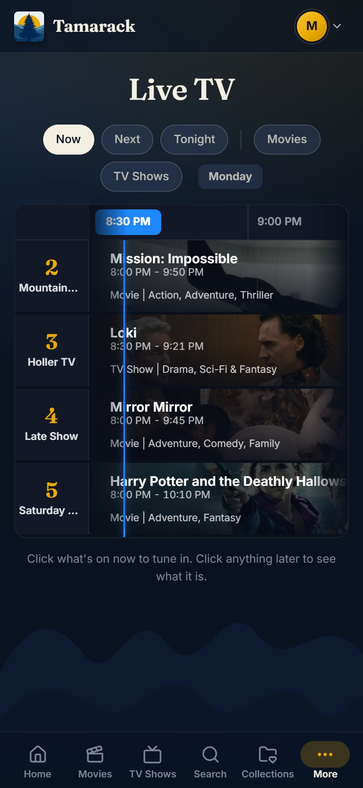 |

| # | | |
|:-:|---|---|
| 1 | **Your menu** | Settings, Administration and Sign out. |
| 2 | **Continue watching** | Swipe sideways for more. |
| 3 | **Tabs** | Home, Movies, TV Shows, Search, Collections and **More** (Live TV, Discover). |

**Back** (the button or the gesture) closes whatever is open, then goes back a screen; on the first screen it puts Tamarack in the background. Long-press a poster to select several.

---

## On Roku

| Where | Buttons |
|---|---|
| **Anywhere** | **\*** slides the menu in: Home, Search, Live TV, each library, Settings, Switch user, Sign out. |
| **Home** | Carry on watching, the next episodes, what's on Live TV now, and the latest in each library. |
| **Search** | A keyboard on the left, results on the right as you type. |
| **A film or show** | **Play**, or **Resume** and **Play from the start**. A show lists its seasons as folders. |
| **Playing** | **OK** shows the controls (back 10 s, play/pause, forward 30 s, next episode, sound and subtitles). With them hidden: **Left / Right** back 10 s / on 30 s, **Rewind / Fast-forward** a minute, **\*** sound and subtitles. |
| **Live TV** | **OK** on a programme tunes in. While watching: **Up / Down** change channel, **Left / Right** open the guide, **Back** leaves. |
| **Music** | A music library opens Holler's player on the TV, with your playlists and liked songs. **Left / Right** skip songs, **Rewind / Fast-forward** move 15 s. Holler on your phone can control it. |
| **Settings** | A quality cap for a slow connection, subtitles on by default, the next episode playing on its own, and updates. |

Your password, picture and Administration are changed in the Windows or Android app, or a browser.

---

## Updating

Tamarack tells you when there's a new version and installs it itself. Nothing is lost: your sign-in stays, and everything else is on the server.

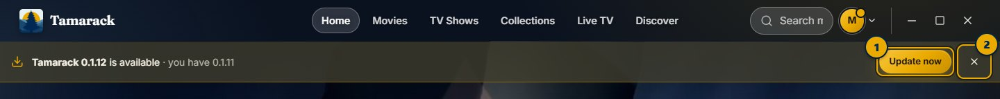

| | Windows | Android | Roku |
|---|---|---|---|
| **You see** | the bar under the header: **1 Update now**, **2 ✕** (later) | the same bar | **Settings → Update to Tamarack 0.x.y** |
| **Then** | It downloads, installs and opens again. | The first time, Android opens **Allow from this source**: turn it on, come back, press **Update now** again. Then **Update**. | Type the Roku's **developer password**. The channel closes and opens on the new version. |

<table><tr>
<td width="260">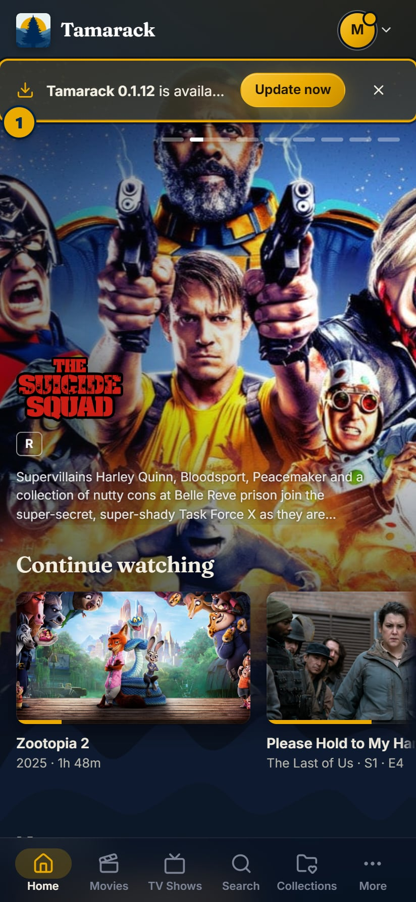</td>
<td>

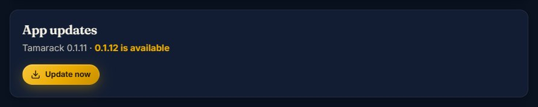 
**Settings → App updates** shows your version and checks again.

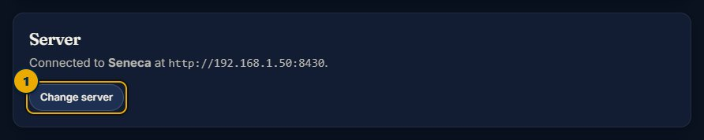 
**Settings → Server** shows which server you're on, and **Change server**.

</td></tr></table>

No update ever shows up? The server you're on can't see the releases: tell whoever runs it (it's [In-app updates](https://github.com/GetHorizontal63/seneca#in-app-updates) in Seneca's README). You can always install the newest version over the old one from the links at the top.

---

## Something wrong?

### 1. "Failed to fetch" or "can't be reached" when connecting

1. Open the same address in a browser **on that device**. If it doesn't load there either, it's the network, not the app.
2. Check the device is on your home Wi-Fi, not mobile data.
3. Use the server's **IP address** (`192.168.…`), not a name like `truenas.local`, and include the port: `:8430`.
4. Still nothing? Ask whoever runs the server to check it's running.

### 2. "It isn't a Seneca server"

Something answered, but not Seneca. Check the port: Seneca uses **8430** unless it was changed.

### 3. A film or show is missing

Your account may have an age limit, or the file hasn't been scanned yet. Ask the administrator.

### 4. A film stutters or keeps buffering

Choose a lower quality in the player (Roku: **Settings → quality**). The server is converting it and can't keep up.

### 5. Subtitles are missing

Picture subtitles (Blu-ray PGS, DVD) can't be shown yet; text subtitles can.

### 6. Android won't install an update ("App not installed")

Your copy was signed differently (built on another PC, or an early version). Uninstall Tamarack and install the new one; you only need to connect and sign in again.

### 7. Windows: "Windows protected your PC"

**More info → Run anyway.** The app isn't signed with a paid certificate.

### 8. Roku: the update says the password was turned down

It's the **developer-mode** password chosen on the Roku, not your Seneca one. Forgotten? Repeat the remote sequence from [Install → Roku](#roku) to set a new one.

### 9. Roku: the channel opens and closes at once

Reinstall the zip from the Roku's address in a browser. If it keeps happening, the Roku's debug console (`telnet <roku-ip> 8085`) says why; pass that on.

---

## For server managers

Tamarack needs nothing on the server beyond Seneca itself.

- **The address** people type is the server's IP and port; give the server a fixed IP on your router.
- **Updates come through your server**, not GitHub: Seneca checks this repository's releases hourly, keeps a copy of each new file and hands it to the apps. If this repository is private, Seneca needs `SENECA_GITHUB_TOKEN`, a read-only token (*Contents: Read-only* on `tamarack` and `holler`). [Details](https://github.com/GetHorizontal63/seneca#in-app-updates).
- **Roku updates** are installed by the server at the Roku's request, with the developer password typed on the TV. It isn't stored, and the server only installs to home-network addresses.
- **Video conversion** happens on the server: direct play is free; each viewer who needs conversion uses about a CPU core.
- **Live TV, collections, requests and age limits** are set up in **Administration**: see [Seneca's README](https://github.com/GetHorizontal63/seneca#admin-in-app).

## For developers

This repository holds only releases. The source is **[Seneca](https://github.com/GetHorizontal63/seneca)**:

| Part | In Seneca | |
|---|---|---|
| The app | `web/` | the browser client built with `vite build --mode tamarack`, which leaves music out (`web/src/edition.ts`) |
| Windows shell | `apps/desktop/` | Electron: loads the build from disk, draws its own window buttons, runs updates quietly |
| Android shell | `apps/android/` | Capacitor, patched by `patch-android.cjs`; `native/` has back handling and the update installer |
| Roku channel | `apps/roku/` | SceneGraph / BrightScript against the same API |
| This page | `apps/tamarack/` | `README.md`, `img/`, and the icon from `apps/icons/tamarack.png` |

To try changes without building: `npm run dev:server` and `npm run dev:tamarack --prefix web`, then `http://localhost:5174`. Builds and releases use `build_apps.py` and `push.py` ([Seneca's developer section](https://github.com/GetHorizontal63/seneca#for-developers), including the Android signing key). Each release attaches `Tamarack.apk`, `Tamarack-Setup.exe` and `Tamarack-Roku.zip` under the same names every time; Seneca's update check depends on them.

Tamarack · for Seneca · almost heaven

